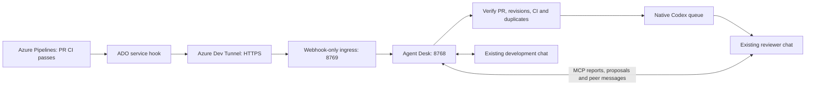

# Agent Desk

**Event-driven Azure DevOps reviews in your existing Codex desktop chats.**

Agent Desk is a local control panel, durable event queue and MCP coordination server.
Your chats remain in Codex: read their responses, send follow-ups and approve work
there. Each agent has a linked chat, role, repository scope, isolated worktrees and
allowed peers. Add agents through configuration, without changing application code.



- **No pipeline edits:** a project service hook supplies successful-build events.
- **No scheduled model polling:** the worker waits for events and queue deadlines.
- **No new chat per review:** delivery targets the registered desktop chat UUID.
- **Human control:** automated reviews prepare assessments. Comments, backlog changes,
  implementation and deployment require an explicit, bounded human approval.
- **Local state:** credentials, events, reports and agent registrations stay outside Git.

Independent community software, not affiliated with or endorsed by OpenAI or Microsoft.

## Requirements

- Linux or Ubuntu WSL, Python **3.12**, [uv](https://docs.astral.sh/uv/getting-started/installation/)
  and Git. Run the Python services in WSL on Windows; native Windows Python is not supported.
- Codex desktop, signed in, and its installed CLI supporting
  [`codex queue --thread <UUID> --message <TEXT>`](https://learn.chatgpt.com/docs/cli/reference).
  The controller checks this command. It does not require a separate shared daemon.
- An Azure DevOps project with readable repositories, builds and PR policies, and a
  **required build-validation policy** on reviewed PRs.
- For remote ADO events: [Azure Dev Tunnels](docs/azure-dev-tunnels.md) and permission
  to create a [service-hook subscription](docs/azure-devops.md).
- Optional: Node.js 22 for the frontend syntax check; systemd user services for startup.

The bridge uses your existing Codex sign-in. It makes no direct OpenAI API requests
and requires no OpenAI API key. Actual reviews consume your normal Codex allowance.
CLI capability and a delivery receipt do not prove that the chat completed a review.
Desktop availability, sign-in and CLI compatibility must be verified on your machine.

## Quick start

Keep the checkout on the native WSL filesystem, rather than a synchronized folder:

```bash
mkdir -p ~/local-repos
git clone https://github.com/hmaldonadovilla/codex-agent-control.git ~/local-repos/codex-agent-control
cd ~/local-repos/codex-agent-control
uv sync --frozen
uv run agent-control --workspace-root "$HOME/local-repos"
```

Open **http://127.0.0.1:8768**. Automation starts paused.

1. **Connections → Codex:** select the installed CLI executable and test it. On WSL,
   an existing Windows `codex.exe` can be selected using its `/mnt/c/...` absolute path.
2. **Agents → Add agent:** register each existing Codex chat UUID, role and instructions.
   Register a reviewer with **Review on CI** enabled, and a developer with it disabled.
   Restrict repository names/IDs and allowed peer IDs as appropriate.
3. Assign separate worktrees. The worktree form creates and registers an isolated
   checkout; explicitly adopt its path in the linked chat. Existing dirty checkouts
   are preserved. Worktrees isolate files, not a shared Kubernetes cluster or database.
4. **Connect reporting** for each agent. This creates an owner-only credential under
   `.local/agents/` and adds its private reporting instructions to that profile.
5. Configure the [Agent Desk MCP server](docs/agents-and-mcp.md). Keep responses in the
   native desktop chats. Refresh the same chats if newly registered tools are missing.
6. Configure [ADO access and CI policies](docs/azure-devops.md), then the dedicated
   [dev tunnel](docs/azure-dev-tunnels.md) and service hook. Test them before enabling
   the reviewer and automation.

You can also seed profiles on a fresh installation:

```bash
uv run agent-control --workspace-root "$HOME/local-repos" \
  --review-thread <existing-review-chat-uuid> \
  --development-thread <existing-development-chat-uuid> \
  --organization <ado-organization> --project '<ado-project>'
```

These options create missing profiles; they do not replace existing chat bindings.

## What happens after CI succeeds?

1. ADO posts an authenticated event to the webhook-only listener through the tunnel.
2. Agent Desk persists and deduplicates the event before acknowledging it. Only
   successful `refs/pull/<id>/merge` builds can trigger automatic reviews. Main,
   release and unrelated builds cannot fan out to other PRs.
3. It independently reads ADO. The PR must be active, non-draft, within the repository
   and author scope, with every enabled blocking build policy passed for its exact
   source or merge revision. Excluding the signed-in author's PRs is the default.
4. A review is deduplicated by agent, repository, PR, source SHA and target SHA. It
   waits **30 seconds** by default, then rechecks the live PR before desktop delivery.
5. The existing reviewer chat checks the live start guard, reviews in its isolated
   worktrees and reports its assessment. Relevant peer messages use Agent Desk to
   reach the existing development chat.
6. Proposed external actions remain pending until a human approves their exact scope.
   Approval queues an action; only its actual report establishes completion.

The grace period is configurable in **Connections → Wait after CI passes** (0–300
seconds). It is one event-driven deadline, not recurring polling. Manual messages
and approved actions are not delayed. Optional local HTTP reconciliation is disabled
by default and can be enabled explicitly to catch missed events.

A PR may be merged after Codex accepts its queued message. The current CLI has no
withdrawal option: that chat can still wake briefly. Its mandatory `get_run` start
guard then stops the stale review before file reads, tests, proposals or peer messages.
See [architecture and limitations](docs/architecture.md).

## Operations and documentation

| Guide | Contents |
| --- | --- |
| [Azure Dev Tunnels](docs/azure-dev-tunnels.md) | Dedicated persistent tunnel, host rewriting, restricted ingress, private configuration and verification |
| [Azure DevOps](docs/azure-devops.md) | PAT permissions, CI policies, manual/automatic service-hook setup, event payloads and diagnostics |
| [Agents and MCP](docs/agents-and-mcp.md) | Native chat registration, extensible roles, peer boundaries, reporting CLI and approvals |
| [Operations](docs/operations.md) | Foreground processes, systemd/WSL startup, backups, upgrades, logs and recovery |
| [Architecture](docs/architecture.md) | Trust boundaries, job lifecycle, revision checks, queue races and legacy adapters |
| [Security](SECURITY.md) | Threat model, secret handling, private vulnerability reports and supported release |
| [Contributing](CONTRIBUTING.md) | Development, synthetic tests and release checks |
| [Changelog](CHANGELOG.md) | Release history |

State defaults to `.local/` in the current working directory. Keep this directory
private: it contains credentials and potentially confidential PR/report data. It is
git-ignored and must not be uploaded to an issue, public artifact or release.
The dashboard is local-only; expose **8769**, never the control port **8768**.

## Development

```bash
uv sync --frozen
uv run ruff check .
uv run ruff format --check .
uv run pytest
node --check src/agent_control/static/app.js
uv build
```

Tests use synthetic credentials and mocked ADO/Codex boundaries. They do not register
live hooks, send real chat messages, call a model or mutate a deployment. GitHub
Actions runs the same checks using pinned action revisions. See [CONTRIBUTING.md](CONTRIBUTING.md).

## License

[MIT](LICENSE), copyright 2026 hmaldonadovilla and contributors.

For active-chat steering, coalesced review delivery and receipt cleanup, see [Desktop delivery](docs/desktop-delivery.md).
